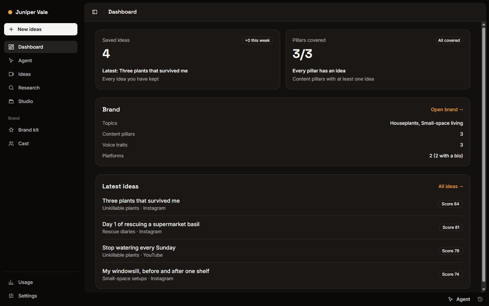
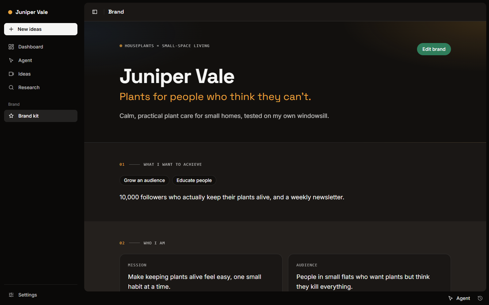
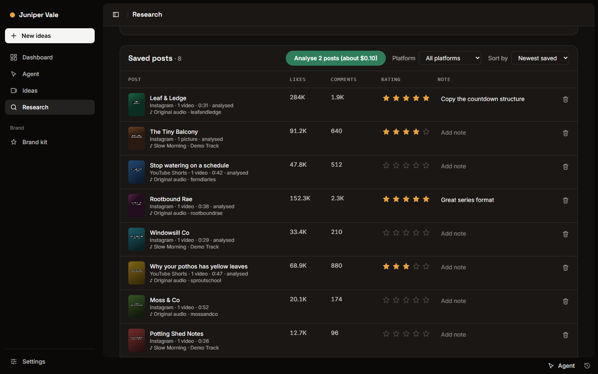
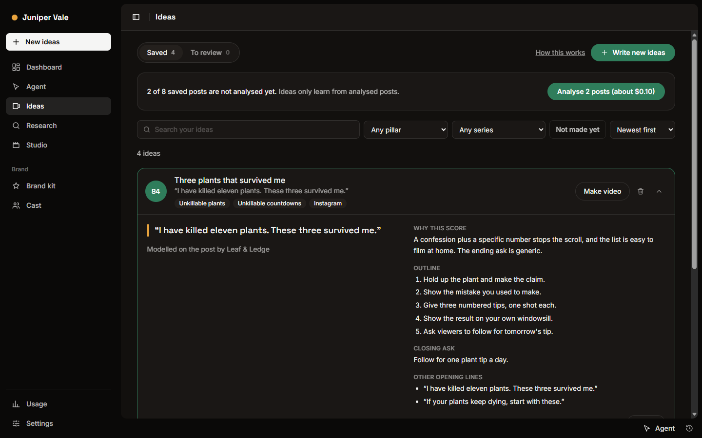

# Personal Brand

A desktop app that helps one creator build a personal brand with short videos (Reels, Shorts, TikTok). You define your brand, save posts that worked for other creators, let Claude break down why they worked, turn that into your own ideas, and make those ideas into videos scripted scene by scene. An in-app agent can do all of it for you from a chat.

Everything runs on your own computer with your own API keys. There are no accounts and no server.


*All screenshots use invented demo data.*

## What it does

| | |
|---|---|
| **Brand kit** | Your name, topics, audience, positioning, content pillars, voice and platform bios in one place. |
| **Research** | Paste an Instagram or YouTube Shorts link and the app saves the video or pictures, the caption, the numbers, the sound used and a transcript. Rate posts and add notes. When a post is analysed it is also put in a group with the saved posts built on the same concept, so similar videos sit together. |
| **Analysis** | Claude looks at frames, transcript and caption and records the hook, the structure and why the post works. Each post is analysed once and the result is saved. |
| **Ideas** | Claude writes many ideas, each modelled on one analysed post, then a separate pass judges them and keeps the best. |
| **Agent** | A chat, available on every screen, that can read and change your brand, research and ideas and carry out the actions above. Type `@` to point it at your brand kit, all of your research or ideas, or one specific post, idea or audio file. Before it changes or deletes anything it shows you what it wants to do and waits for you to allow it; **Settings → Agent tool permissions** sets which actions ask first. |
| **Studio** | Turns a saved idea, or your own version of a saved post, into a video script written as scenes. The idea already says whether it is a single video or a series and whether it is made with AI only, filmed by you, or a mix; each scene is marked as made with AI or filmed by you; the claim is checked against your rules, and you approve the script before anything costly is made. Series get a season plan with a running question. A Cast step lists the characters a script uses, where each role can be given to a character you already have so its voice and pictures are reused. AI lines are spoken in each character's voice. With a fal.ai, Google or ElevenLabs key, a Storyboard step makes one storyboard for each scene, a sheet of four frames showing what happens in it, and you look through the whole video that way before anything costly is made. The Make step then makes each clip to follow its storyboard, and you choose which service does which job. A scene that carries on from the one before is drawn from the storyboard before it, and its clip opens on the last frame of that scene's clip, so the two play as one take. |
| **Characters** | Characters you make once and reuse in any video or series: personality, way of talking, look and an ElevenLabs voice. |
| **Audio** | With an ElevenLabs key, the agent can make voiceovers in a voice from your account (including your own cloned voice), sound effects and music, and plays them in the chat. |
| **Usage** | Shows what the app has used on your services and what for: Claude tokens and their estimated cost, minutes transcribed, and audio generated. |
| **Telegram** | Send links to your own Telegram bot from your phone and they are saved to Research. |

## Screenshots

**Dashboard**



**Brand kit**



**Research: saved posts with rating and notes**



**Analysis of one post**


**A saved idea**



## What you need

- **Node.js 22.13 or newer**, and Git.
- **An Anthropic API key** for analysis, ideas, scripts and the agent. Create one at [console.anthropic.com](https://console.anthropic.com).
- Optional: **a Deepgram API key** to transcribe what is said in videos ([deepgram.com](https://deepgram.com)).
- Optional: **an ElevenLabs API key** so the agent can generate voiceovers, sound effects and music ([elevenlabs.io](https://elevenlabs.io)).
- Optional: **a fal.ai or Google Gemini API key** to make pictures and clips for scenes in Studio ([fal.ai](https://fal.ai), [aistudio.google.com](https://aistudio.google.com)). ElevenLabs can do this too on its Pro plan.
- Optional: **a Telegram bot token** to save links from your phone (create a bot with [@BotFather](https://t.me/BotFather)).

The app is developed on Windows. It downloads the tools it needs (yt-dlp, and FFmpeg on Windows and Linux) the first time you save a post. On macOS there is no automatic FFmpeg download, so videos are saved at lower quality.

## Install and run

```bash
git clone https://github.com/neolen-services/neobranding.git
cd neobranding
npm install
npm run dev
```

`npm run dev` opens the desktop app. There is no packaged installer yet; you run it from source.

## First steps

1. **Create your brand.** The app opens on a short set of questions: who you are, what you cover, who it is for and what you want to achieve.
2. **Add your Claude key.** Open **Settings** (bottom of the menu) and paste your Anthropic API key. Add the Deepgram key and Telegram token there too if you want them.
3. **Save posts you like.** In **Research**, paste a link to a public Instagram post (reel, video, photo or carousel) or a YouTube Short. Give the good ones a star rating and a note.
4. **They are analysed for you.** Each new post is analysed as soon as it is saved (about $0.06 on your Claude account) and put in a group with the saved posts built on the same concept. You can switch this off on the Research page; **Analyse posts** then does it when you ask. You need at least five analysed posts before ideas can be written, unless you tick the posts to learn from.
5. **Write ideas.** In **Ideas**, press **Write new ideas**, say whether you want single videos or series and how they will be made, and save the ones you like.
6. **Make it.** Press **Make video** on a saved idea, or pick the idea in **Studio**. Studio writes the script as scenes for you to approve; a series idea gets its season planned first.

Or ask the agent: press **Agent** in the top-right corner on any screen and type what you want, for example "Analyse my saved posts and give me five ideas".

### Saving links from your phone

1. In Telegram, message [@BotFather](https://t.me/BotFather), send `/newbot` and follow the steps. Copy the token it gives you.
2. Paste the token in **Settings → Telegram bot**.
3. Send any message to your new bot. The first chat to message it becomes the linked chat.
4. From then on, send the bot an Instagram or YouTube Shorts link and it is saved to Research while the app is open.

## What it costs

The app is free. The AI features use your own Anthropic account, so you pay Anthropic directly. Typical amounts:

| Action | Rough cost |
|---|---|
| Analyse one post | $0.06 |
| One round of ideas (writes many, keeps the best) | $0.25 |
| One video script in Studio | $0.10 |
| A question to the agent | $0.05 to $0.15, plus whatever actions it runs |

The app shows the estimated cost on each button before you press it. Saving posts and rating them is free. Transcription uses your Deepgram account, and generated audio uses your ElevenLabs credits.

## Your data

Everything you create is kept in **one folder** on your computer, by default `Documents/Personal Brand`:

- `personal-brand.db`: your brand, ideas, cast, series, videos and their scripts, agent chats and saved keys
- `videos/` and `cast/`: the pictures and clips made for scenes, and characters' reference pictures
- `usage.jsonl`: a log of what the app used on your services, shown on the Usage page
- `research/`: saved posts with their videos, pictures, captions, transcripts, analyses, ratings and notes
- `audio/`: voiceovers, sound effects and music you generated
- `telegram.json`: which Telegram chat is linked

**Settings → Your data** shows where the folder is, opens it, and lets you move it.

### Moving to another computer

1. Copy the whole folder to the other computer (a USB drive or a synced folder both work).
2. Install and run the app there.
3. In **Settings → Your data**, choose the copied folder.
4. Enter your API keys again. On the desktop app, keys are encrypted by the operating system, so they cannot be read on a different computer.

Nothing is sent anywhere except to the services you connect: your brand details and post content go to Anthropic when you use an AI feature, audio goes to Deepgram when a video is transcribed, the text or description for generated audio goes to ElevenLabs, and links arrive through Telegram if you set up a bot.

## For developers

- `npm run dev`: the desktop app.
- `npm run dev:web`: the interface in a browser at `http://localhost:5173`, using the same data folder. Run one or the other, not both, or two copies will read the same Telegram bot.
- `npm run typecheck`: type-check everything.
- `npm run build`: type-check and build.

To try the app without touching your real data, point it at another folder:

```bash
PERSONAL_BRAND_DATA_DIR=/path/to/a/test/folder npm run dev:web
```

Built with Electron, React, TypeScript, Tailwind CSS and SQLite (Node's built-in `node:sqlite`). `CLAUDE.md` describes the project's rules and how the code is laid out.

## Known limits

- Instagram does not show view counts or video length without a login, so those are often missing.
- Only Instagram posts and YouTube Shorts links are accepted.
- Links sent to Telegram are saved only while the app is open.
- Actions set to "Ask first" cannot run until you allow them. The agent's rules about spending are instructions it follows, not hard locks.

## Licence

[PolyForm Noncommercial 1.0.0](LICENSE). You may use, change and share this software for personal and other non-commercial purposes. Commercial use needs permission from the copyright owner, Neolen Services Private Limited.

The code is public but, because commercial use is restricted, this is "source-available" software rather than open source in the strict sense.
